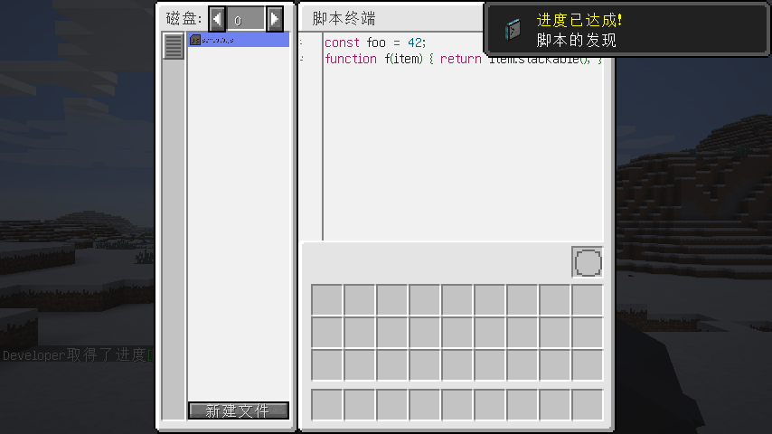
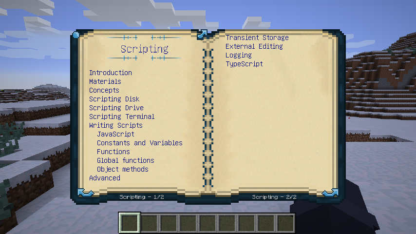

# 集成脚本：回调 · Integrated Scripting Callback

**Minecraft 1.12.2 · Forge · MIT** —— 给《动态联合》（Integrated Dynamics）加上写代码的能力：**在网络里直接写 JavaScript**。



> 在游戏内的脚本终端里写 JavaScript，把常量或函数绑定到变量卡上，它就能像普通变量卡一样在整个网络里使用：
> 在显示器上显示值，或者当作运算符去过滤物品列表、写进集成管道的过滤器。
>
> 本模组是 [Integrated Scripting](https://github.com/CyclopsMC/IntegratedScripting)（作者 **rubensworks**）的**非官方 1.12.2 移植版**。

---

## 目录

- [这是什么](#这是什么)
- [环境要求](#环境要求)
- [安装](#安装)
- [快速上手](#快速上手)
- [合成表](#合成表)
- [脚本终端使用说明](#脚本终端使用说明)
- [怎么把脚本变成变量卡](#怎么把脚本变成变量卡)
- [脚本怎么写](#脚本怎么写)
- [更多示例](#更多示例)
- [脚本文件在哪里（外部编辑）](#脚本文件在哪里外部编辑)
- [配置项](#配置项)
- [命令](#命令)
- [常见问题](#常见问题)
- [已知限制](#已知限制)
- [致谢与许可](#致谢与许可)
- [English summary](#english-summary)

---

## 这是什么

《动态联合》的逻辑是"可视化编程"：把运算符拖进逻辑编程器，用变量卡一层层拼。功能强大，但一旦要做"把箱子物品里可堆叠、且堆叠量 ≥ 16 的挑出来，再按数量排序"这种事，变量卡就会堆成一片。

本模组提供另一条路：**写代码**。

- 在游戏内的**脚本终端**里编辑多个磁盘上的多个脚本文件，带语法高亮、自动缩进、括号补全、代码补全下拉框、撤销/重做、自动保存
- 脚本里的 `const` / `let` 变量 → 绑定成**变量卡**（值）
- 脚本里的函数 → 绑定成**运算符卡**（Operator），可以当过滤器、断言用
- 动态联合的**全部值类型双向互通**：整数、长整数、浮点、布尔、字符串、列表、NBT、物品、方块、流体……
- `idContext.ops` 里能调用全部内置运算符（本版本实测 233 个全局运算符 + 13 组对象方法）
- 文件直接落在存档目录，**可以用外部编辑器改**，存盘后游戏里自动热重载
- 自动生成 TypeScript 类型声明 `.d.ts`，在外部 IDE 里写脚本有补全
- `console.log()` / `console.error()` 输出到脚本旁边的 `.stdout` / `.stderr` 文件
- 附带《论动态联合》信息书的「脚本」章节与「脚本教程」章节，配 7 个进度（外加一个隐藏的起始进度）

## 环境要求

| 组件 | 要求 |
|---|---|
| Minecraft | **1.12.2** |
| Forge | 14.23.5.2847 / 2859（1.12.2 主流版本） |
| Java | **8** |
| 动态联合 Integrated Dynamics | 1.12.2 版（开发与测试基于 1.1.11）**必需** |
| CyclopsCore | 1.12.2-1.6.7 **必需**（动态联合自带依赖） |
| CommonCapabilities | 1.12.2-2.x **必需**（动态联合自带依赖） |
| **Integrated Scripting Callback Libs** | **必需**，见下 |

### 关于配套库模组 `integratedscriptingcallbacklibs`

JavaScript 运行时（GraalVM JS 21.3.0）**不在本模组里**，而是由配套的库模组 `integratedscriptingcallbacklibs` 提供，两个 jar 要一起放进 `mods/`。

没装库模组时：游戏能正常启动，方块、物品、终端界面都在，但**执行脚本会报错**：

> 未安装 JavaScript 运行时（…）。请安装配套模组 integratedscriptingcallbacklibs。

**客户端与服务端都必须安装**：客户端要跑终端界面，服务端要编译和执行脚本。

## 安装

1. 装好 Forge 1.12.2 与 Java 8（客户端 + 服务端）
2. 把以下 jar 放进 `mods/`：
   - 动态联合 + CyclopsCore + CommonCapabilities
   - `Integrated-Scripting-Callback-1.12.2-<版本>.jar`（本模组）
   - `integratedscriptingcallbacklibs-<版本>.jar`（运行时库）
3. 启动一次游戏生成配置：`config/integratedscriptingcallback.cfg`

> 单人存档与服务器要装同一套；多人服务器只让玩家装客户端是不够的。

## 快速上手

### 1. 先造点门山石

「门山石」是本模组一切物品的基础材料，由**烘干池**制造：

**1 个安山岩 + 1000 mB 门瑞欧树脂 → 1 个门山石**

- 普通烘干池：300 刻
- 电动烘干池：15 刻（更快，但要耗电）

### 2. 做三件套

| 物品 | 作用 |
|---|---|
| **脚本磁盘** | 存脚本。空磁盘可以叠放，一旦写进过 ID 就不堆叠了 |
| **脚本驱动器** | 方块。放进一张脚本磁盘，把这个磁盘"暴露"给网络 |
| **脚本终端** | 线缆部件。右键打开编辑器，管理网络里所有驱动器上的脚本 |

### 3. 搭起来

1. 把**脚本驱动器**接进你的动态联合网络（挨着线缆，或者和其它方块一样接上）
2. **右键脚本驱动器**，打开它的小界面，把**脚本磁盘**放进唯一的槽位 —— 这时磁盘会获得一个数字 **磁盘 ID**（从 0 开始递增），物品提示里能看到 `ID: 0`
3. 在连着同一个网络的线缆上放一个**脚本终端**
4. **右键脚本终端** —— 编辑界面打开

> 终端和驱动器都要吃网络能量（默认：驱动器 2、终端 1，会乘上动态联合的能量倍率）。能量不够时右键终端会提示"低能量"。

### 4. 写第一行脚本

1. 打开终端，左上角显示当前磁盘号；点左下角的 **「新建文件」**，会得到一个 `script0.js`
2. 点左边列表里的 `script0.js`，在右边编辑器里输入：

```js
const myVar = 123;
```

3. 用鼠标**双击选中** `myVar` 这个词
4. 把一张**空的变量卡**插进界面右下角的槽位

这张变量卡现在就"等于 123"了。把它放进**显示器**，就能看到 `123`。

## 合成表

| 成品 | 材料 |
|---|---|
| **门山石** | 烘干池：1 安山岩（`minecraft:stone`，meta 5）+ 1000 mB 门瑞欧树脂 → 1 门山石 |
| **脚本磁盘 ×8** | 4 变量卡（十字形）+ 1 门山石 |
| **脚本驱动器** | 3 脚本磁盘 + 1 变量卡箱 + 1 唱片机 |
| **脚本终端**（部件） | 4 红石粉 + 1 门山石 + 1 变量输出 + 1 变量输入 + 1 显示器 |

具体摆法看 NEI / JEI，或者翻开游戏内的《论动态联合》→「动态联合手册」→「脚本」章节，里面有配方附录和截图（教程在「教程」→「脚本教程」）：



## 脚本终端使用说明

界面大致是这样：

```
┌───────────────────────────────────────────────┐
│ 磁盘: [<] 0 [>]   脚本终端                    │
├───────────────┬───────────────────────────────┤
│ 脚本文件列表  │   编辑器（语法高亮 + 行号）   │
│  script0.js   │  const foo = 42;              │
│  script1.js   │  function f(item) { ... }     │
│               │                               │
│               │                      [变量卡] │
├───────────────┤                               │
│ [新建文件]    │                               │
└───────────────┴───────────────────────────────┘
```

- **左上角磁盘选择器**：点箭头切换磁盘，也可以直接在里面输入磁盘 ID
- **左下角「新建文件」**：在当前磁盘新建一个空脚本，文件名自动为 `script0.js`、`script1.js`……
- **左侧列表**：点一下选中文件，右边就会显示内容；鼠标停在一行上时，行尾会出现**红色 ×**，点它弹出确认框，确认后删除文件
- **右侧编辑器**：边写边自动保存（约每秒同步一次到服务端）；带行号、滚动条、自动缩进、括号补全、代码补全下拉框、撤销/重做、当前行与配对括号高亮
- **右下角槽位**：放**空的变量卡**，用来绑定当前选中的成员

> 支持的脚本扩展名：`.js`、`.cjs`、`.mjs`。

编辑器按 [CodeMirror](https://codemirror.net/) 的编辑模型实现（自动缩进、close-brackets、history、增量布局、补全下拉框），完整键位与设计说明见 [`docs/EDITOR.md`](docs/EDITOR.md)。

| 按键 | 行为 |
|---|---|
| `Enter` | 换行并保持/增加缩进；在空的 `{}` 中间回车会展开成三行 |
| `Tab` / `Shift+Tab` | 缩进到下一个制表位 / 整行反缩进 |
| `(` `[` `{` `'` `"` | 自动补全成对符号；有选区时包裹选区；字符串/注释里不补全 |
| `)` `]` `}` / 引号 | 右边已有同一符号时跳过；行首输入 `}` 会自动反缩进 |
| 输入标识符 / `Ctrl+Space` / `.` | 输入第 2 个字符时自动弹出补全；`Ctrl+Space` 显式打开；`.` 打开对象方法候选 |
| 补全中 | `↑`/`↓` 选择、`PageUp`/`PageDown` 翻页、`Enter`/`Tab`/鼠标点击插入、`Esc` 关闭 |
| `Ctrl+/` | 切换行注释 |
| `Ctrl+D` / `Ctrl+Shift+K` / `Alt+↑` `Alt+↓` | 复制行 / 删除行 / 上下移动行 |
| `Ctrl+Z` / `Ctrl+Y`（或 `Ctrl+Shift+Z`） | 撤销 / 重做，连续输入合并成一步 |
| `Home` / `Ctrl+Home` / `Ctrl+End` | 智能行首 / 文档开头 / 文档结尾 |
| `Ctrl+A/C/V/X`、双击、三击 | 全选、复制、粘贴、剪切；选中单词、选中整行 |

## 怎么把脚本变成变量卡

这是本模组最核心的操作，只有两步：

1. **在编辑器里选中一个名字** —— 双击选中一个变量名或函数名（比如 `myVar`、`filterItem`）
2. **把一张空的变量卡放进右下角槽位**

绑定后：

- 选中的是**变量** → 得到一张普通的**变量卡**（提示框里能看到它指向的磁盘/路径/成员），可以插进显示器、逻辑编程器、任意接受值的地方
- 选中的是**函数** → 得到一张**运算符卡**，可以当过滤器/断言用，比如「过滤器」运算符的断言参数

变量卡的提示框会显示它实际指向的位置：`磁盘 ID` / `脚本路径` / `成员`，方便排查。

> ⚠️ 绑定记录的是「**磁盘 ID + 文件路径 + 成员名**」这三件事。所以：
> - 磁盘可以换到别的驱动器、别的网络位置 —— 只要**同一网络内**，绑定依然有效
> - 但**重命名、移动或删除脚本文件**，已绑定的变量卡就会失效并开始报错
> - 磁盘拿到新 ID（比如把磁盘 NBT 清掉）也会让旧卡失效

## 脚本怎么写

### 语言

标准 **JavaScript（ECMAScript / ECMA-262）**。

**不可用**：Node.js 的那一套 —— `require`、`fs`、`process`、`module`。想复用 npm 上的代码，得先用 Webpack 之类的工具打包成单文件。

### 值与类型

动态联合的全部值类型都能在脚本里直接用，反过来也一样：

| 脚本里 | 动态联合 |
|---|---|
| `true` / `false` | Boolean |
| `123` / `-5` | Integer |
| 带小数的数 | Double |
| `"文本"` / 模板字符串 | String |
| `[1, 2, 3]` | List |
| `{ a: 1, b: 2 }` | NBT（复合标签） |
| 物品 / 方块 / 流体 / 实体值 | 对应的对象值类型 |

```js
const myBoolean = true;
let myInt = 123 + 456;

let myString = "";
for (let i = 0; i < 50; i++) {
  myString += ".";
}

const myList = [1, 1, 2, 3, 5];
```

### 函数就是运算符

用 `function` 关键字或箭头函数都能创建运算符。函数的参数会收到动态联合传进来的值（已转换成 JS 值），返回值会转回动态联合的值。

```js
function isEven(value) {
  return value % 2 === 0;
}

const isOdd = (value) => value % 2 !== 0;
```

选中 `isEven` 并插入变量卡 → 得到「运算符」卡 → 可以塞进任何接受运算符的地方。

### 调用内置运算符：`idContext.ops`

全局变量 `idContext.ops` 里放着动态联合的全部内置运算符，直接当函数调：

```js
function filterItem(item) {
  return idContext.ops.itemstackStackable(item)
      && idContext.ops.itemstackSize(item) >= 16;
}
```

运算符名就是它在 1.12 版动态联合里的引擎名（小驼峰），例如 `itemstackStackable`、`itemstackSize`、`blockIsplantable`。想知道某个运算符叫什么：

- 在**逻辑编程器**里悬停看它的全局名
- 或者看存档目录下的 `operator-bindings.log`，里面把全部可用的脚本函数名（全局运算符 + 各值类型的方法）连同参数类型一起列了出来
- 或者直接看自动生成的 `.d.ts` 类型声明

嫌啰嗦可以先把运算符存成常量：

```js
const isStackable = idContext.ops.itemstackStackable;
const size = idContext.ops.itemstackSize;

function filterItemCompact(item) {
  return isStackable(item) && size(item) >= 16;
}
```

### 对象方法（更推荐）

物品、方块、流体这类**对象值**身上挂着方法，第一个参数被自动绑定到对象自己，写起来更短：

```js
function filterItemMethods(item) {
  return item.stackable() && item.size() >= 16;
}

function harderThanTen(item, block) {
  return item.strength(block) > 10;
}
```

规则：全局函数 `foo(a, b)` 在对象上就是 `a.foo(b)`，**所有参数左移一位**。

### 状态：可以，但是临时的

函数外声明的 `let` 变量会跨调用保留，所以能做计数器、滑动平均：

```js
let sum = 0;
let count = 0;

function runningAverage(value) {
  count++;
  sum += value;
  return sum / count;
}
```

但**不要依赖它持久化**：任何一张变量卡被重新插入、脚本被重新编译、服务器重启，这些值都可能回到初始状态。要真正持久化，请用「延迟器」那一套。

### NBT 只能是复合标签

1.12.2 的 NBT 值类型只装得下 **compound**（`{ ... }`）。把标量（数字/字符串）当 NBT 传会报错：

> 值类型 … 不是 NBT 复合标签；打开 `nbtScalarWrapper` 配置项可以包装标量。

打开该配置后，标量会被包成 `{ "value": <值> }`。默认关闭，因为它是显式降级。

复合标签在脚本里就是个普通对象，成员直接点出来：

```js
function sumOfAB(nbt) {
  return nbt.a + nbt.b;
}
```

### 调试日志

```js
function myComplexFunc(value) {
  console.log('Hello world!');
  console.log(`I received value ${value}`);
  console.error('这条进 stderr');
  return value + 42;
}
```

- `console.log` → 脚本旁边的 `<脚本名>.stdout`
- `console.error` → `<脚本名>.stderr`

日志文件每个最多 **2096 行**（可配置），超出后自动截断旧内容。这些文件在终端里也能看到。

## 更多示例

**斐波那契数列**（返回列表，可以直接在显示器上显示）：

```js
function fibonacci(limit) {
  const values = [];
  let n1 = 0;
  let n2 = 1;
  for (let i = 1; i <= limit; i++) {
    values.push(n1);
    const next = n1 + n2;
    n1 = n2;
    n2 = next;
  }
  return values;
}
```

**箱子物品过滤**（教程里的完整例子）：
「物品容器读取器」读出物品列表 →「过滤器」→ 断言用下面这个函数 → 结果丢给显示器。

```js
function filterItem(item) {
  return item.stackable() && item.size() >= 16;
}
```

**用表格做映射**：

```js
const names = { 0: 'zero', 1: 'one', 2: 'two' };
function nameOf(value) {
  return names[value] || 'many';
}
```

**字符串就是普通 JS 字符串**（所有内置方法都能用）：

```js
function shout(text) {
  return text.toUpperCase() + '!';
}
```

> 技巧：函数体里具体能用哪些方法，取决于对象值类型挂的运算符。第一次写不确定的话，先把全局函数版本跑通，再换成方法写法。

## 脚本文件在哪里（外部编辑）

脚本以**纯文本文件**的形式存在存档里，位置固定：

```
saves/<世界名>/integratedscriptingcallback/
├── scripting-disks/
│   ├── 0/                  ← 磁盘 ID 0
│   │   ├── script0.js
│   │   └── script0.js.stdout
│   └── 1/                  ← 磁盘 ID 1
├── integratedscriptingcallback.d.ts    ← TypeScript 类型声明（自动生成）
└── operator-bindings.log               ← 可用的脚本函数名清单（含参数类型）
```

- 服务器上是 `<服务器目录>/world/integratedscriptingcallback/`
- 脚本文件 UTF-8 编码，扩展名 `.js` / `.cjs` / `.mjs`
- **游戏运行时也可以改**：外部保存后，游戏会自动检测到变化、重新加载，依赖该脚本的变量卡会刷新
- 反过来也成立：在终端里改脚本，外部编辑器（支持自动重载的）里也会跟着变
- `.d.ts` 每次开服/开档都会重新生成，**不要手改**

## 配置项

文件：`config/integratedscriptingcallback.cfg`（改完需要重启游戏）

| 配置 | 默认值 | 说明 |
|---|---|---|
| `versionChecker` | `false` | 更新检查。本移植版没有公开的更新清单，保持关闭以免日志 404 |
| `scriptingDriveBaseConsumption` | `2` | 脚本驱动器的基础耗能 |
| `terminalScriptingBaseConsumption` | `1` | 脚本终端的基础耗能 |
| `terminalScriptingClientSyncTickInterval` | `20` | 客户端→服务端同步脚本改动的最小间隔（刻） |
| `graalStatementLimit` | `16384` | **单次求值**最多执行多少条语句，防止死循环；`-1` 关闭（不建议） |
| `maxLogLines` | `2096` | `.stdout` / `.stderr` 的最大行数；`-1` 关闭限制 |
| `nbtScalarWrapper` | `false` | 把标量 NBT 参数包成 `{ "value": … }` 而不是直接报错 |

**沙箱开关**（`graalAllow*`，默认全部危险项关闭，改动都要重启）：

| 开关 | 默认 | 放开后允许脚本… |
|---|---|---|
| `graalAllowCreateProcess` | `false` | 启动进程 |
| `graalAllowCreateThread` | `false` | 创建线程 |
| `graalAllowIo` | `false` | 读写文件 |
| `graalAllowHostClassLoading` | `false` | 加载宿主类 |
| `graalAllowExperimentalOptions` | `false` | 使用实验性选项 |
| `graalAllowEnvironment` | `false` | 读取环境变量 |
| `graalAllowNative` | `false` | 访问 native 接口 |
| `graalAllowHostPublicAccess` | `false` | 调用任意 public 构造器 |
| `graalAllowHostAllImplementations` | `false` | 实现任意 Java 接口 |
| `graalAllowHostAllClassImplementations` | `false` | 继承任意 Java 类 |
| `graalAllowHostAccessInheritance` | `false` | 通过继承获得访问权 |
| `graalAllowHostArray/List/Buffer/Iterable/Iterator/MapAccess` | `true` | 数据容器的常规访问（保持开启即可） |

> ⚠️ 这些开关是给**私有服务器 + 你完全信任的玩家**准备的。放开 `graalAllowIo` / `graalAllowNative` 之类等于把服务器交给脚本，公服不要动。

## 命令

都需要 **OP 权限等级 2**：

| 命令 | 说明 |
|---|---|
| `/integratedscriptingcallback testscript` | 运行时自检：跑一小段脚本，把标量、列表、NBT、物品、方块、运算符、对象方法全走一遍，成功时返回 `testscript ok, result 10` |
| `/integratedscriptingcallback testfacade <磁盘> <路径> <成员> [x y z]` | 变量卡门面自检：按显示器的方式解析脚本成员并写入/读回变量卡；带坐标时会走真实的网络解析路径 |

脚本出错时，游戏里看到的是本地化的错误文字（例如"在当前网络中找不到 ID 为 3 的磁盘"），不会把堆栈糊到玩家脸上，也不会崩服。

## 常见问题

**装了但一执行脚本就说缺 JavaScript 运行时？**
没装配套库模组 `integratedscriptingcallbacklibs`，或者只装在客户端。两个 jar 要同时进客户端和服务端的 `mods/`。

**磁盘插进驱动器了，但没有 ID？**
要**右键驱动器**打开它的小界面，把磁盘放进槽位 —— ID 是在放入的那一刻分配的，放进去后物品提示会出现 `ID: N`。ID 由存档的全局计数器发号，不会重复。

**变量卡报"找不到网络 / 磁盘 / 成员"？**
按顺序排查：终端和驱动器是否在**同一个网络** → 那张磁盘是否还插在某个驱动器里 → 文件是否被改名/删除 → 成员名是否拼错（大小写敏感）。

**报"已编译脚本因文件变化被释放，请再次求值"？**
这是正常提示：脚本文件被改过，旧的编译结果已作废。让它再求值一次就好（重新插一下变量卡、或触发一次更新都行）。

**改了脚本，显示器还是旧值？**
保存到服务端有约 1 秒的间隔（`terminalScriptingClientSyncTickInterval`），重新看一次就好。

**脚本里能不能读文件、发网络请求？**
不能。默认沙箱禁掉 IO / 进程 / 线程 / native，只有数据访问是开的（见配置项）。

**多人服务器上谁能编辑脚本？**
任何能打开该脚本终端的玩家都能编辑这个网络暴露的所有脚本 —— 本模组没有细粒度权限控制。开公服前请考虑这一点。

**为什么不能重命名脚本文件？**
终端里没有重命名功能，新建时按 `script0.js`、`script1.js` 自动取名。要改名请去文件系统改，但注意：**改名会让已绑定的变量卡失效**（绑定按路径记录）。

## 已知限制

- **编辑器只高亮，不检查语法错误**。语法错误要等变量卡求值时才报出来；改对之后会自动恢复。
- 每次求值最多执行 `16384` 条语句（`graalStatementLimit`），超过就报错。它是防死循环的安全网，不要指望在里面跑长循环。
- 变量状态（`let`）是**临时的**，随时可能重置。
- **NBT 只支持复合标签**，标量需要开 `nbtScalarWrapper`。
- 只支持 **JavaScript**（`.js` / `.cjs` / `.mjs`）。TypeScript 只提供 `.d.ts` 给外部编辑器，游戏里不编译 TS。
- 没有 Node.js 的 `require` / `fs` 等能力。
- 脚本日志文件（`.stdout` / `.stderr`）目前也会出现在终端的文件列表里，选中它们会提示语言不支持 —— 已知的界面小问题。
- 编辑器不做语法检查、多光标或查找/替换面板；自动补全下拉框已支持（自动弹出、成员补全、鼠标点击、翻页），自动缩进按括号与上一行缩进推断，不解析 AST。
- 纯客户端装本模组没有意义，逻辑全在服务端。

## 致谢与许可

- 原版 **Integrated Scripting**：© **rubensworks**（CyclopsMC），MIT 许可。<https://github.com/CyclopsMC/IntegratedScripting>
- 1.12.2 移植与中文翻译：本仓库维护者。
- 《动态联合》与 CyclopsCore：rubensworks 与 CyclopsMC 团队。
- JavaScript 运行时：**GraalVM**（`graal-sdk`、`js` 21.3.0），Universal Permissive License 1.0，全文见 `LICENSE-graal.txt`。
- 本仓库代码与素材：**MIT**，见 [LICENSE](LICENSE)。

本模组是**非官方**移植，与 CyclopsMC 无隶属关系；原版的问题请勿报到上游。

> 开发者：构建方式、移植决策与验收记录在 [`docs/PORTING-1.12.2.md`](docs/PORTING-1.12.2.md)、[`docs/MILESTONES.md`](docs/MILESTONES.md)、[`docs/AUDIT.md`](docs/AUDIT.md)；编辑器的设计与键位见 [`docs/EDITOR.md`](docs/EDITOR.md)；给模组加语言/补全能力的接入指南见 [`docs/LANGUAGE-API.md`](docs/LANGUAGE-API.md)。

---

## English summary

**Integrated Scripting Callback** is an unofficial **Minecraft 1.12.2 / Forge** port of
[Integrated Scripting](https://github.com/CyclopsMC/IntegratedScripting) by rubensworks.

Write **JavaScript** inside your Integrated Dynamics network:

- Craft **Mendesite** (drying basin: andesite + 1000 mB menril resin), then **Scripting Disks**,
  a **Scripting Drive** (exposes one disk to the network) and a **Scripting Terminal** (the in-game IDE).
- Put a disk in a drive to give it a numeric **disk ID**; open the terminal on the same network to
  create, edit and delete `.js` files on every exposed disk. The in-game editor follows CodeMirror's
  editing model: auto-indent, bracket/quote completion, undo/redo, line commands, matching-bracket
  and active-line highlighting, plus stateful highlighting across multi-line comments and template
  literals (see [`docs/EDITOR.md`](docs/EDITOR.md)).
- Select a name in the editor (e.g. `const myVar = 123;`) and insert an **empty Variable Card** into
  the slot — the card now carries that constant, or, if you selected a function, an **Operator** card
  usable as a filter. All Integrated Dynamics value types, operators (`idContext.ops.*`) and object
  methods (`item.stackable()`) are available.
- Scripts live in `world/integratedscriptingcallback/scripting-disks/<id>/`, can be edited with an
  external editor while the game runs, and a `.d.ts` typings file plus `operator-bindings.log` are
  generated on every world start. `console.log()` goes to `<script>.stdout`.

**Requirements:** Minecraft 1.12.2, Java 8, Integrated Dynamics + CyclopsCore + CommonCapabilities,
and the companion runtime mod **`integratedscriptingcallbacklibs`** (GraalVM JS). Without it the game
starts but scripts report a missing JavaScript runtime. Install on **both** client and server.

**Sandbox:** file I/O, processes, threads and native access are disabled by default; a statement
limit (16384) guards against infinite loops. All serverside evaluation, no client-side scripting.

Documentation for the port: [`docs/PORTING-1.12.2.md`](docs/PORTING-1.12.2.md); the editor design,
keymap and performance notes are in [`docs/EDITOR.md`](docs/EDITOR.md). Licensed MIT;
GraalVM is UPL 1.0 (`LICENSE-graal.txt`).
